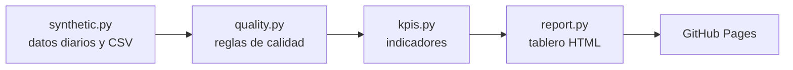

# industrial-kpi-dashboard

[](https://github.com/Jcrodri2/industrial-kpi-dashboard/actions/workflows/ci.yml)
[](https://github.com/Jcrodri2/industrial-kpi-dashboard/actions/workflows/pages.yml)

Tablero de indicadores de producción de un campo petrolero, construido en Python con **datos sintéticos**: genera la producción diaria por pozo, valida la calidad de los datos, calcula los KPIs y publica un tablero HTML en cada cambio.

**Demo:** [jcrodri2.github.io/industrial-kpi-dashboard](https://jcrodri2.github.io/industrial-kpi-dashboard/)

## Qué resuelve

En muchas operaciones los indicadores diarios se arman a mano en Excel: se copian datos, se corrigen errores a ojo y el informe llega tarde. Este proyecto muestra el flujo automatizado de punta a punta:

1. **Datos:** producción diaria de petróleo, agua y gas por pozo, con declinación, corte de agua creciente y paradas.
2. **Calidad:** reglas que detectan duplicados, valores negativos, horas fuera de rango, producción sin operación y fechas faltantes.
3. **KPIs:** producción acumulada y promedio, corte de agua, disponibilidad y declinación mensual por pozo.
4. **Tablero:** un HTML estático sin dependencias, desplegado en GitHub Pages por GitHub Actions.

## Arquitectura



## Cómo correrlo en 5 minutos

Requiere Python 3.11 o superior.

```bash
git clone https://github.com/Jcrodri2/industrial-kpi-dashboard.git
cd industrial-kpi-dashboard
python -m venv .venv
source .venv/bin/activate        # en Windows: .venv\Scripts\activate
pip install -e ".[dev]"
python -m kpi_dashboard --wells 12 --days 180 --seed 42 --out site
pytest
```

Abre `site/index.html` en el navegador. Para usar tus propios datos, pasa un CSV con las columnas `date, well, oil_bopd, water_bwpd, gas_kscfd, uptime_h`:

```bash
python -m kpi_dashboard --input mis_datos.csv --out site --strict
```

Con `--strict`, el comando termina con error si encuentra problemas de calidad, útil para frenar un informe con datos malos.

| Código de salida | Significado |
| --- | --- |
| 0 | Tablero construido |
| 1 | Hay problemas de calidad y se usó `--strict` |
| 2 | El CSV no existe, le faltan columnas, trae valores inválidos o está vacío |

## KPIs calculados

| KPI | Definición |
| --- | --- |
| Petróleo acumulado | Suma de barriles de petróleo del periodo |
| Promedio del campo | Barriles por día (bopd) promedio del campo |
| Corte de agua | Agua / (petróleo + agua) |
| Disponibilidad | Horas en operación / horas calendario |
| Declinación mensual | Ajuste exponencial sobre los días con operación completa |

## Calidad del proyecto

- Pruebas con pytest en Python 3.11 y 3.14, con cobertura mínima de 80 % exigida en CI.
- Tablero sin scripts: una política de seguridad de contenido (CSP) bloquea cualquier JavaScript o recurso externo.
- Lint y formato con ruff.
- Dependabot para dependencias y acciones, y análisis de seguridad con CodeQL.
- Decisiones de diseño documentadas en [docs/adr](docs/adr).

## Datos

Todos los datos son sintéticos y se generan con una semilla fija. No representan pozos ni operaciones reales.

## Licencia

[MIT](LICENSE)

---

**In English:** Oil field production KPI dashboard in Python with synthetic data: data generation, data-quality rules, KPIs and a static HTML dashboard deployed to GitHub Pages by GitHub Actions. No runtime dependencies. MIT license.
